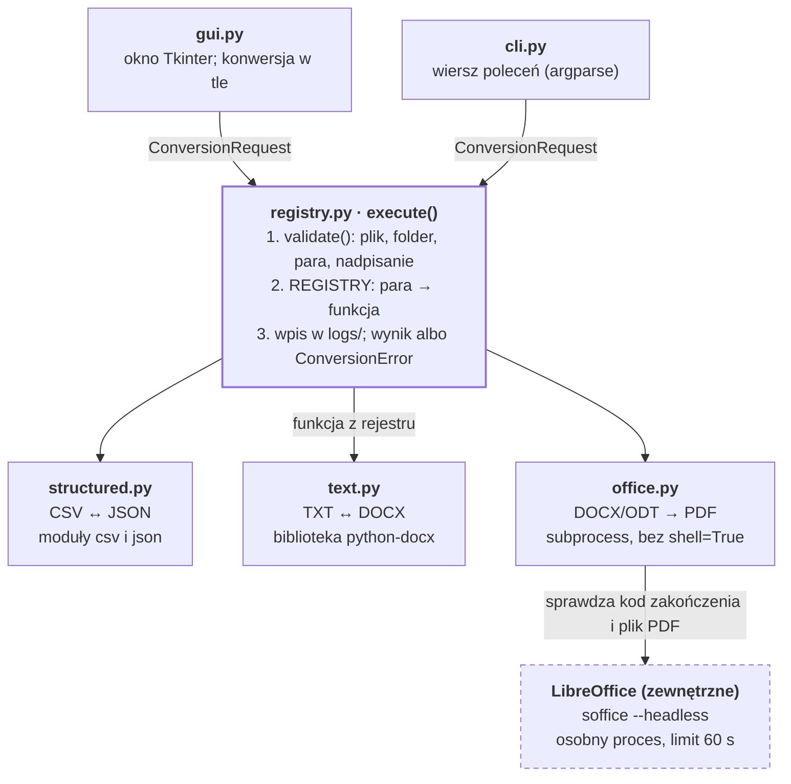

# Uniwersalny konwerter plików

Aplikacja desktopowa w Pythonie (Tkinter/ttk), która dla wybranego pliku pokazuje tylko dostępne formaty docelowe i wykonuje konwersję w 6 kierunkach z trzech grup: CSV ↔ JSON, TXT ↔ DOCX oraz DOCX/ODT → PDF. Te same konwersje można uruchamiać z wiersza poleceń.

## Obsługiwane konwersje

Aplikacja obsługuje 6 kierunków konwersji, po dwa z każdej grupy wymaganej w instrukcji. Inne pary nie są pokazywane w GUI i są odrzucane w wierszu poleceń.

| Kierunek | Grupa | Narzędzie | Znane ograniczenia |
| --- | --- | --- | --- |
| CSV → JSON | A – dane strukturalne | csv, json (wbudowane) | wszystkie wartości zapisywane jako tekst |
| JSON → CSV | A – dane strukturalne | csv, json (wbudowane) | tylko lista płaskich obiektów; zagnieżdżone obiekty i listy trafiają do komórki jako tekst |
| TXT → DOCX | B – tekst i dokumenty | python-docx | każda linia to osobny akapit; plik musi być w UTF-8 |
| DOCX → TXT | B – tekst i dokumenty | python-docx | tylko tekst akapitów; formatowanie, znaczniki list, tabele, nagłówki, stopki i obrazy są pomijane |
| DOCX → PDF | C – formaty biurowe | LibreOffice (headless) | wygląd zależy od czcionek w systemie |
| ODT → PDF | C – formaty biurowe | LibreOffice (headless) | wygląd zależy od czcionek w systemie |

## Wymagania

| Składnik | Wersja | Uwagi |
| --- | --- | --- |
| Python z Tkinterem | 3.11+ (sprawdzono 3.11–3.14) | instalator z python.org zawiera Tkinter; na Linuksie pakiet `python3-tk` |
| python-docx | 1.2.0 | odczyt i zapis DOCX; instalowany z `requirements.txt` |
| pytest | aktualna | tylko do testów; instalowany z `requirements.txt` |
| LibreOffice | aktualna | zależność systemowa, tylko do konwersji do PDF |

### Zależność systemowa: LibreOffice

LibreOffice (https://www.libreoffice.org) jest wyszukiwane w zmiennej PATH oraz w domyślnych miejscach instalacji:

- Windows: `C:\Program Files\LibreOffice\program\soffice.exe`
- macOS: `/Applications/LibreOffice.app/Contents/MacOS/soffice`

Inną lokalizację wskazuje się zmienną środowiskową `LIBREOFFICE_PATH` (pełna ścieżka do programu `soffice`). Przed konwersją zamknij otwarte okna LibreOffice. Bez LibreOffice pozostałe konwersje działają, a konwersja do PDF kończy się komunikatem z instrukcją.

## Instalacja

Windows (PowerShell), w folderze projektu:

```powershell
py -m venv .venv
.venv\Scripts\activate
python -m pip install -r requirements.txt
```

Jeśli PowerShell zablokuje aktywację, uruchom raz `Set-ExecutionPolicy -Scope CurrentUser RemoteSigned`.

Linux / macOS:

```bash
python3 -m venv .venv
source .venv/bin/activate
python -m pip install -r requirements.txt
```

## Uruchomienie

Polecenia uruchamia się z głównego folderu projektu, z aktywnym środowiskiem `.venv`.

### Aplikacja okienkowa

```powershell
python -m file_converter.gui
```

1. Kliknięcie pola „Wybierz plik” (z symbolem „+”) – wskazanie pliku do konwersji. Po wyborze pole pokazuje ikonę z rozszerzeniem i nazwę pliku; ponowne kliknięcie pozwala wybrać inny plik. Nieobsługiwany plik jest oznaczony na czerwono.
2. Wybór formatu z listy „Format eksportu”; lista zawiera tylko formaty dostępne dla wybranego pliku.
3. „Konwertuj” – aplikacja sprawdza wybór (plik, jego istnienie, obsługiwany format) i w razie problemu pokazuje komunikat. Jeśli wszystko się zgadza, otwiera systemowe okno „Zapisz jako” z podpowiedzianą nazwą (np. `people.json`), którą można zmienić; o zastąpieniu istniejącego pliku pyta system.
4. Stan pracy widać na pasku statusu; wynik i ewentualne błędy są pokazywane w oknie komunikatu w stylu aplikacji.

### Wiersz poleceń

```powershell
python -m file_converter.cli <plik> <format> <folder> [--overwrite]
```

Format podaje się z kropką, folder zapisu musi istnieć, a istniejący plik wynikowy jest nadpisywany tylko z opcją `--overwrite`.

```powershell
mkdir output
python -m file_converter.cli samples\people.csv .json output
python -m file_converter.cli samples\sample.txt .docx output
python -m file_converter.cli samples\formatted.docx .pdf output
python -m file_converter.cli samples\people.csv .json output --overwrite
```

## Formaty danych i decyzje projektowe

### CSV ↔ JSON

Akceptowany JSON to tablica płaskich obiektów, jeden obiekt na wiersz CSV; inna struktura jest odrzucana z komunikatem.

```json
[
  {"name": "Zażółć Gęślą", "city": "Łódź", "phone": "123456789"},
  {"name": "Kowalski, Jan", "city": "Kraków", "phone": ""}
]
```

| Zagadnienie | Decyzja |
| --- | --- |
| Nagłówki | pierwszy wiersz CSV to nazwy kolumn i klucze obiektów; kolejność kolumn jest zachowana; przy JSON → CSV kolumny to wszystkie klucze w kolejności pierwszego wystąpienia |
| Separator | wejście: przecinek lub średnik, wykrywany automatycznie (gdy wykrycie jest niemożliwe, np. przy jednej kolumnie – przecinek); wyjście: średnik, jak w polskim Excelu |
| Kodowanie | wejście: UTF-8 z BOM lub bez; CSV wyjściowy: UTF-8 z BOM (poprawne polskie znaki w Excelu); JSON wyjściowy: UTF-8 bez BOM |
| Wartości | wszystkie zapisywane jako tekst (`"007"` zostaje `"007"`); pusta komórka to `""`, a `null` w JSON daje pustą komórkę |
| Brakujący klucz | pusta komórka w CSV |

### TXT ↔ DOCX

Każda linia pliku TXT staje się osobnym akapitem DOCX, a pusta linia pustym akapitem, więc odstępy są zachowane. DOCX → TXT zapisuje tekst kolejnych akapitów w osobnych liniach; konwersja TXT → DOCX → TXT daje ten sam tekst.

### DOCX / ODT → PDF

Konwersję wykonuje LibreOffice w trybie bez okna (`--headless`), uruchamiane przez `subprocess.run` z listą argumentów, bez `shell=True`, z limitem 60 s.

- Sukces potwierdzają dwa warunki: kod zakończenia 0 oraz istnienie pliku PDF, bo LibreOffice potrafi zwrócić 0 bez utworzenia pliku.
- Przed wywołaniem sprawdzane jest, czy plik jest archiwum ZIP (DOCX i ODT nim są). LibreOffice rozpoznaje plik po zawartości, więc bez tego zwykły tekst z rozszerzeniem `.docx` zostałby zamieniony na PDF bez błędu.
- Jedna funkcja obsługuje obie pary, bo polecenie LibreOffice jest dla DOCX i ODT identyczne.

## Architektura

Logika konwersji jest oddzielona od interfejsu: GUI i wiersz poleceń tworzą to samo zlecenie `ConversionRequest` i wywołują tę samą funkcję `execute()`.



Konwertery nie znają interfejsu, więc nowa para formatów to nowa funkcja `(source: Path, output_dir: Path) -> Path` w folderze `converters/` i jedna linia w słowniku `REGISTRY`; GUI i CLI nie wymagają zmian. `execute()` uruchamia konwerter w folderze tymczasowym i dopiero gotowy plik przenosi pod docelową ścieżkę: przy błędzie nie zostaje niepełny plik, LibreOffice nie nadpisze innego pliku o tej samej nazwie, a w GUI można wybrać dowolną nazwę pliku wynikowego (pole `target_name` w `ConversionRequest`; CLI używa nazwy pliku źródłowego). GUI uruchamia konwersję w wątku roboczym i co 100 ms sprawdza jej zakończenie, więc okno nie zamarza podczas pracy LibreOffice.

| Plik | Odpowiedzialność |
| --- | --- |
| `file_converter/converters/structured.py` | konwersje CSV ↔ JSON |
| `file_converter/converters/text.py` | konwersje TXT ↔ DOCX |
| `file_converter/converters/office.py` | DOCX/ODT → PDF, wyszukiwanie LibreOffice |
| `file_converter/registry.py` | rejestr par formatów, `available_targets()`, `ConversionRequest.validate()`, `execute()` |
| `file_converter/errors.py` | wspólny wyjątek `ConversionError` |
| `file_converter/log_config.py` | konfiguracja dziennych plików logu w folderze `logs/` |
| `file_converter/cli.py` | interfejs wiersza poleceń |
| `file_converter/gui.py` | interfejs okienkowy Tkinter/ttk |
| `tests/` | testy pytest rejestru i konwerterów |
| `samples/` | dane testowe |

## Walidacja, obsługa błędów i logowanie

Wszystkie przewidziane błędy są zgłaszane jako wspólny wyjątek `ConversionError` z komunikatem zawierającym przyczynę i dalszy krok. GUI pokazuje go w oknie błędu, a wiersz poleceń wypisuje go i kończy się kodem 1.

| Obszar | Co jest sprawdzane | Gdzie |
| --- | --- | --- |
| Wejście | istnienie pliku i folderu zapisu; niepuste wybory w GUI | `ConversionRequest.validate()`, `gui.py` |
| Para formatów | czy para jest w rejestrze; GUI pokazuje tylko dostępne formaty | `validate()`, `available_targets()` |
| Zapis i nadpisanie | konflikt nazw (pytanie systemowego okna „Zapisz jako” w GUI, opcja `--overwrite` w CLI); rozszerzenie nazwy pliku wynikowego zgodne z formatem; brak dostępu do zapisu, np. plik otwarty w Excelu | `validate()`, `execute()` |
| Błędna treść | składnia i struktura JSON, kodowanie inne niż UTF-8, uszkodzony DOCX lub ODT | konwertery |
| Brak zależności | brak LibreOffice: komunikat z instrukcją instalacji lub ustawienia `LIBREOFFICE_PATH` | `office.py` |
| Kontrola procesu | limit czasu 60 s, kod zakończenia, istnienie pliku wynikowego | `office.py` |

Każda konwersja jest zapisywana w folderze `logs/` w głównym folderze projektu, niezależnie od miejsca uruchomienia: sukcesy z czasem trwania, błędy z komunikatem, a nieprzewidziane błędy z pełnym śladem stosu. Nieprzewidziany błąd nie zamyka aplikacji – GUI pokazuje komunikat z odesłaniem do pliku logu.

| Plik | Zawartość |
| --- | --- |
| `logs/converter.log` | wszystkie wpisy (INFO i ERROR) – pełny przebieg pracy |
| `logs/errors.log` | tylko błędy (ERROR) – szybki przegląd problemów |

Każdego dnia powstają nowe pliki, a pliki z poprzednich dni dostają datę w nazwie (np. `converter.log.2026-11-11`). Przechowywanych jest 10 ostatnich plików każdego rodzaju, starsze są usuwane automatycznie (`TimedRotatingFileHandler` z biblioteki standardowej).

## Dane testowe

Folder `samples/` zawiera 8 plików: poprawne dane z każdej grupy oraz pliki celowo błędne.

| Plik | Zawartość | Operacja | Oczekiwany wynik |
| --- | --- | --- | --- |
| `people.csv` | separator `,`, polskie znaki, pusta komórka, wartość z przecinkiem w cudzysłowie | → JSON | JSON z 3 obiektami o kluczach `name`, `city`, `phone`; pusta komórka jako `""`; powrót do CSV daje te same dane |
| `people_excel.csv` | separator `;`, UTF-8 z BOM (zapis z Excela) | → JSON | JSON jak wyżej, separator wykryty automatycznie |
| `broken.json` | brak przecinka między polami | → CSV | komunikat o błędzie składni z numerem linii i kolumny; plik CSV nie powstaje |
| `not_a_list.json` | pojedynczy obiekt zamiast listy | → CSV | komunikat o niepoprawnej strukturze |
| `sample.txt` | dwa akapity rozdzielone pustą linią, polskie znaki | → DOCX | DOCX z akapitami odpowiadającymi liniom; powrót do TXT daje ten sam tekst |
| `formatted.docx` | nagłówek, pogrubienie, lista punktowana | → TXT, → PDF | TXT z samym tekstem; PDF wyglądający jak dokument |
| `notes.odt` | dokument z LibreOffice Writer | → PDF | PDF z treścią dokumentu |
| `broken.docx` | zwykły tekst z rozszerzeniem `.docx` | → TXT, → PDF | komunikat o niepoprawnym lub uszkodzonym dokumencie |

## Raport testów

Wszystkie 17 testów automatycznych przechodzi, a wszystkie przypadki minimalnej macierzy testów są zaliczone. Logi poniżej pochodzą z uruchomienia projektu na czystym środowisku, przygotowanym dokładnie według sekcji „Instalacja” (Linux, Python 3.12.3, python-docx 1.2.0, LibreOffice 24.2). Projekt był rozwijany i testowany także na Windows z Pythonem 3.14; tam ścieżki w poleceniach zapisuje się z `\`.

### Testy automatyczne

Uruchomienie: `python -m pytest -v`. Bez LibreOffice test tworzenia PDF jest pomijany (`skipped`), a pozostałe przechodzą.

| Test | Co sprawdza |
| --- | --- |
| `test_available_targets_for_docx` | formaty dla pliku `.DOCX`, także zapisanego wielkimi literami |
| `test_available_targets_for_unsupported_file` | brak formatów dla nieobsługiwanego pliku |
| `test_validate_accepts_correct_request` | poprawne zlecenie przechodzi walidację |
| `test_validate_rejects_missing_file` | brak pliku wejściowego |
| `test_validate_rejects_unsupported_pair` | nieobsługiwana para formatów |
| `test_validate_rejects_existing_target_without_overwrite` | konflikt nazw; nadpisanie tylko za zgodą |
| `test_validate_rejects_target_name_with_wrong_extension` | nazwa pliku wynikowego z rozszerzeniem innym niż format |
| `test_execute_saves_file_under_chosen_name` | `execute()` zapisuje wynik pod wybraną nazwą i nie zostawia innych plików |
| `test_csv_json_round_trip_keeps_polish_characters_and_empty_values` | CSV → JSON → CSV: polskie znaki, puste wartości, kolejność kolumn |
| `test_csv_to_json_detects_semicolon` | CSV ze średnikiem i BOM (Excel) |
| `test_csv_to_json_accepts_single_column` | CSV z jedną kolumną |
| `test_csv_to_json_rejects_non_utf8_file` | CSV w kodowaniu Windows-1250 daje komunikat |
| `test_json_to_csv_rejects_broken_json` | błędny JSON daje komunikat i nie zostawia pliku |
| `test_txt_docx_round_trip_keeps_paragraphs` | TXT → DOCX → TXT zachowuje akapity |
| `test_docx_to_txt_rejects_broken_file` | uszkodzony DOCX daje komunikat |
| `test_document_to_pdf_reports_missing_libreoffice` | brak LibreOffice (zmiana `LIBREOFFICE_PATH`) |
| `test_document_to_pdf_creates_pdf` | LibreOffice tworzy prawdziwy plik PDF |

Log uruchomienia:

```text
============================= test session starts ==============================
platform linux -- Python 3.12.3, pytest-9.2.0, pluggy-1.7.0 -- /home/claude/Projekt I/.venv/bin/python
cachedir: .pytest_cache
rootdir: /home/claude/Projekt I
collecting ... collected 15 items

tests/test_converters.py::test_csv_json_round_trip_keeps_polish_characters_and_empty_values PASSED [  6%]
tests/test_converters.py::test_csv_to_json_detects_semicolon PASSED      [ 13%]
tests/test_converters.py::test_csv_to_json_accepts_single_column PASSED  [ 20%]
tests/test_converters.py::test_csv_to_json_rejects_non_utf8_file PASSED  [ 26%]
tests/test_converters.py::test_json_to_csv_rejects_broken_json PASSED    [ 33%]
tests/test_converters.py::test_txt_docx_round_trip_keeps_paragraphs PASSED [ 40%]
tests/test_converters.py::test_docx_to_txt_rejects_broken_file PASSED    [ 46%]
tests/test_converters.py::test_document_to_pdf_reports_missing_libreoffice PASSED [ 53%]
tests/test_converters.py::test_document_to_pdf_creates_pdf PASSED        [ 60%]
tests/test_registry.py::test_available_targets_for_docx PASSED           [ 66%]
tests/test_registry.py::test_available_targets_for_unsupported_file PASSED [ 73%]
tests/test_registry.py::test_validate_accepts_correct_request PASSED     [ 80%]
tests/test_registry.py::test_validate_rejects_missing_file PASSED        [ 86%]
tests/test_registry.py::test_validate_rejects_unsupported_pair PASSED    [ 93%]
tests/test_registry.py::test_validate_rejects_existing_target_without_overwrite PASSED [100%]

============================== 15 passed in 0.54s ==============================
```

### Minimalna macierz testów

| Przypadek | Jak sprawdzono | Wynik |
| --- | --- | --- |
| Poprawny plik w każdej grupie | CLI (log niżej) i GUI: `people.csv` → JSON, `sample.txt` → DOCX, `formatted.docx` i `notes.odt` → PDF; pliki wynikowe otwierają się poprawnie | zaliczony |
| Błędny lub uszkodzony plik | CLI (log niżej) i GUI: `broken.json`, `not_a_list.json`, `broken.docx`; komunikat zamiast awarii, GUI działa dalej | zaliczony |
| Nieobsługiwana para | GUI: dla pliku `.png` lista formatów jest zablokowana, a „Konwertuj” pokazuje komunikat; dla `.csv` lista zawiera tylko JSON; CLI: `.csv` → `.pdf` odrzucone przed konwersją | zaliczony |
| Brak LibreOffice | `LIBREOFFICE_PATH` ustawione na nieistniejącą ścieżkę, potem konwersja do PDF: komunikat z instrukcją | zaliczony |
| Plik docelowy już istnieje | GUI: okno „Zapisz jako” pyta o zastąpienie („Nie” niczego nie zmienia); CLI bez `--overwrite` zgłasza konflikt | zaliczony |
| Polskie znaki i puste wartości | porównanie `people.csv` z wynikiem CSV → JSON → CSV (niżej) | zaliczony |

Log z wiersza poleceń:

```text
# 1. Poprawny plik w każdej grupie
> python -m file_converter.cli samples/people.csv .json output
Utworzono: output/people.json
  (kod wyjścia: 0)
> python -m file_converter.cli output/people.json .csv output
Utworzono: output/people.csv
  (kod wyjścia: 0)
> python -m file_converter.cli samples/people_excel.csv .json output
Utworzono: output/people_excel.json
  (kod wyjścia: 0)
> python -m file_converter.cli samples/sample.txt .docx output
Utworzono: output/sample.docx
  (kod wyjścia: 0)
> python -m file_converter.cli samples/formatted.docx .txt output
Utworzono: output/formatted.txt
  (kod wyjścia: 0)
> python -m file_converter.cli samples/formatted.docx .pdf output
Utworzono: output/formatted.pdf
  (kod wyjścia: 0)
> python -m file_converter.cli samples/notes.odt .pdf output
Utworzono: output/notes.pdf
  (kod wyjścia: 0)

# 2. Błędny lub uszkodzony plik
> python -m file_converter.cli samples/broken.json .csv output
Błąd: Plik broken.json nie jest poprawnym JSON-em (linia 2, kolumna 18). Popraw składnię pliku i spróbuj ponownie.
  (kod wyjścia: 1)
> python -m file_converter.cli samples/not_a_list.json .csv output
Błąd: Plik not_a_list.json ma niepoprawną strukturę: oczekiwano listy obiektów. Zapisz dane w formacie opisanym w README.
  (kod wyjścia: 1)
> python -m file_converter.cli samples/broken.docx .txt output
Błąd: Plik broken.docx nie jest poprawnym dokumentem DOCX. Otwórz go w Wordzie lub LibreOffice i zapisz ponownie jako .docx.
  (kod wyjścia: 1)
> python -m file_converter.cli samples/broken.docx .pdf output
Błąd: Plik broken.docx jest uszkodzony albo nie jest dokumentem .docx. Otwórz go w edytorze tekstu i zapisz ponownie.
  (kod wyjścia: 1)

# 3. Nieobsługiwana para
> python -m file_converter.cli samples/people.csv .pdf output
Błąd: Nie można przekonwertować pliku .csv na .pdf. Dostępne formaty dla tego pliku: .json.
  (kod wyjścia: 1)

# 4. Brak LibreOffice (LIBREOFFICE_PATH wskazuje nieistniejący plik)
> LIBREOFFICE_PATH=/brak/soffice python -m file_converter.cli samples/formatted.docx .pdf output --overwrite
Błąd: Nie znaleziono LibreOffice. Zainstaluj je ze strony libreoffice.org albo ustaw zmienną LIBREOFFICE_PATH na ścieżkę do programu soffice.
  (kod wyjścia: 1)

# 5. Plik docelowy już istnieje
> python -m file_converter.cli samples/people.csv .json output
Błąd: Plik people.json już istnieje w folderze output. Zezwól na nadpisanie albo wybierz inny folder.
  (kod wyjścia: 1)
> python -m file_converter.cli samples/people.csv .json output --overwrite
Utworzono: output/people.json
  (kod wyjścia: 0)
```

Porównanie wejścia i wyjścia (CSV → JSON → CSV): te same wiersze, kolumny i polskie znaki, pusta komórka zachowana; zmienia się tylko separator, zgodnie z decyzją projektową.

```text
samples/people.csv                    output/people.csv
name,city,phone                       name;city;phone
Zażółć Gęślą,Łódź,123456789           Zażółć Gęślą;Łódź;123456789
"Kowalski, Jan",Kraków,               Kowalski, Jan;Kraków;
Łucja Źdźbło,Gdańsk,987654321         Łucja Źdźbło;Gdańsk;987654321
```

Wpisy w `logs/converter.log` z tej sesji:

```text
2026-11-12 12:09:21,016 INFO samples/people.csv -> .json: utworzono output/people.json w 0.00 s
2026-11-12 12:09:21,143 INFO output/people.json -> .csv: utworzono output/people.csv w 0.00 s
2026-11-12 12:09:21,271 INFO samples/people_excel.csv -> .json: utworzono output/people_excel.json w 0.00 s
2026-11-12 12:09:21,404 INFO samples/sample.txt -> .docx: utworzono output/sample.docx w 0.02 s
2026-11-12 12:09:21,543 INFO samples/formatted.docx -> .txt: utworzono output/formatted.txt w 0.01 s
2026-11-12 12:09:21,996 INFO samples/formatted.docx -> .pdf: utworzono output/formatted.pdf w 0.35 s
2026-11-12 12:09:22,398 INFO samples/notes.odt -> .pdf: utworzono output/notes.pdf w 0.29 s
2026-11-12 12:09:22,520 ERROR samples/broken.json -> .csv: Plik broken.json nie jest poprawnym JSON-em (linia 2, kolumna 18). Popraw składnię pliku i spróbuj ponownie.
2026-11-12 12:09:22,632 ERROR samples/not_a_list.json -> .csv: Plik not_a_list.json ma niepoprawną strukturę: oczekiwano listy obiektów. Zapisz dane w formacie opisanym w README.
2026-11-12 12:09:22,740 ERROR samples/broken.docx -> .txt: Plik broken.docx nie jest poprawnym dokumentem DOCX. Otwórz go w Wordzie lub LibreOffice i zapisz ponownie jako .docx.
2026-11-12 12:09:22,851 ERROR samples/broken.docx -> .pdf: Plik broken.docx jest uszkodzony albo nie jest dokumentem .docx. Otwórz go w edytorze tekstu i zapisz ponownie.
2026-11-12 12:09:22,968 ERROR samples/people.csv -> .pdf: Nie można przekonwertować pliku .csv na .pdf. Dostępne formaty dla tego pliku: .json.
2026-11-12 12:09:23,073 ERROR samples/formatted.docx -> .pdf: Nie znaleziono LibreOffice. Zainstaluj je ze strony libreoffice.org albo ustaw zmienną LIBREOFFICE_PATH na ścieżkę do programu soffice.
2026-11-12 12:09:23,198 ERROR samples/people.csv -> .json: Plik people.json już istnieje w folderze output. Zezwól na nadpisanie albo wybierz inny folder.
2026-11-12 12:09:23,319 INFO samples/people.csv -> .json: utworzono output/people.json w 0.00 s
```

## Znane ograniczenia

Poza ograniczeniami poszczególnych par z tabeli „Obsługiwane konwersje”:

- Pliki wejściowe muszą być w UTF-8; pliki w Windows-1250 („ANSI”, np. zwykły „CSV” z polskiego Excela) dają komunikat z prośbą o ponowny zapis w UTF-8.
- Separator CSV jest wykrywany tylko spośród przecinka i średnika.
- Wiersze CSV z inną liczbą pól niż nagłówek nie są odrzucane: nadmiarowe wartości trafiają do JSON pod klucz `null`, a brakujące mają wartość `null`.
- Dokument Office innego typu przemianowany na `.docx` zostanie przez LibreOffice przekonwertowany na PDF.
- Podczas konwersji do PDF okna LibreOffice powinny być zamknięte.
- Zamknięcie okna aplikacji w trakcie konwersji kończy program dopiero po jej zakończeniu (najpóźniej po 60 s).

## Historia zmian

Praca była prowadzona w repozytorium Git; stan po każdym laboratorium oznaczono tagiem, a pełną historię pokazuje `git log --oneline`.

| Tag | Zakres |
| --- | --- |
| `lab5` | dzienne pliki logów, obsługa plików spoza UTF-8 i CSV z jedną kolumną, nowy wygląd GUI z oknem „Zapisz jako”, 17 testów automatycznych, README z raportem testów |
| `lab4` | rejestr konwerterów z walidacją i polityką nadpisywania, GUI w Tkinter z konwersją w wątku roboczym |
| `lab3` | TXT ↔ DOCX (python-docx), DOCX/ODT → PDF (LibreOffice), wykrywanie LibreOffice |
| `lab2` | CSV ↔ JSON, wspólny wyjątek, wiersz poleceń, dane przykładowe, macierz konwersji |

## Źródła, biblioteki i narzędzia AI

Biblioteki: `python-docx` (odczyt i zapis DOCX) i `pytest` (testy); narzędzie zewnętrzne: LibreOffice. Pozostałe moduły pochodzą z biblioteki standardowej Pythona.

Narzędzia AI: podczas realizacji projektu korzystano z narzędzia Claude (Anthropic). Wykorzystany kod został przeanalizowany i przetestowany przez autora.

Dokumentacja:

- Python: [csv](https://docs.python.org/3/library/csv.html), [json](https://docs.python.org/3/library/json.html), [pathlib](https://docs.python.org/3/library/pathlib.html), [argparse](https://docs.python.org/3/library/argparse.html), [subprocess](https://docs.python.org/3/library/subprocess.html), [tkinter](https://docs.python.org/3/library/tkinter.html), [tkinter.filedialog](https://docs.python.org/3/library/dialog.html), [concurrent.futures](https://docs.python.org/3/library/concurrent.futures.html), [logging](https://docs.python.org/3/library/logging.html)
- [python-docx](https://python-docx.readthedocs.io/)
- [LibreOffice – parametry wiersza poleceń](https://help.libreoffice.org/latest/en-US/text/shared/guide/start_parameters.html)
- [pytest](https://docs.pytest.org/)
- Real Python: [CSV](https://realpython.com/python-csv/), [JSON](https://realpython.com/python-json/), [pytest](https://realpython.com/pytest-python-testing/)